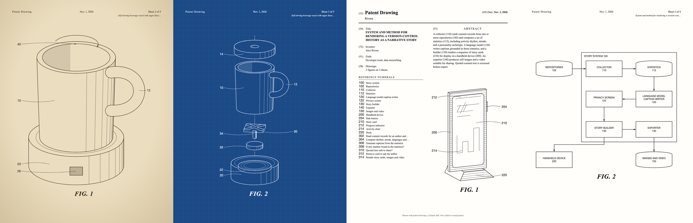

# Patent Drawing

**Any idea, drawn like a 1960s patent.** A Claude skill that turns an invention (a gadget, a product concept, your side project, a piece of software, or something gloriously useless) into a set of patent drawing sheets: black ink line art, shade lines, numbered parts with curved lead lines, FIG. 1, FIG. 2, and a front page with an abstract in deadpan legal prose.



You get:

- **`patent.html`**: every sheet in one page. Switch between Classic, Vintage and Blueprint, hover a numeral to light up its part, and print.
- **`patent-<style>.pdf`**: letter-size and print-ready.
- **`png/sheet-N-<style>.png`**: 1700×2200 posters.
- **`sheets/sheet-N.svg`**: vector files for anything else.

## What it can draw

| | |
|---|---|
| **Perspective views** | Boxes, cylinders and cones, extruded outlines (gears, stars, any shape), spheres, tubes for handles and cables, screens with glass reflections and UI sketched on them. Drawn back to front with white fills, and shade lines on the dark side the way patent draftspeople did it. |
| **Exploded views** | Parts pulled apart along a dash-dot centerline. |
| **Method flowcharts** | Start/end pills, steps, decisions with YES/NO loops, step numerals with lead lines. |
| **System block diagrams** | Blocks on a grid, data stores, groups with their own numeral, arrows that route around blocks. |
| **Front page** | Title, inventor, field, abstract, the reference-numeral list, and FIG. 1. |

## Install

```bash
git clone https://github.com/monish-instinct/patent-drawing ~/.claude/skills/patent-drawing
```

Needs Node 18+. PDF and PNG export use Chrome, Chromium, Edge or Brave. No `npm install`.

## Use

In Claude Code:

> Draw my idea as a patent: a toaster that tweets every time it burns something

> Make vintage patent art of our app for the office wall

> Patent drawing of a self-watering plant pot, exploded view please

Claude plans the figures, models the parts, numbers them like a patent, writes the abstract, renders, looks at every sheet, fixes what's off, and exports.

### Without Claude

Write a spec (see [`references/spec.md`](references/spec.md) and the two [examples](examples)) and run:

```bash
node scripts/build.mjs my-spec.mjs --out patent-out
node scripts/export.mjs --dir patent-out --theme vintage
```

## Examples

- [Self-stirring beverage vessel](examples/self-stirring-mug): a mug that stirs itself and plays a triumphant chime when the sugar dissolves. Perspective, exploded view, method, electronics. [PDF](examples/self-stirring-mug/out/patent-vintage.pdf)
- [Code Wrapped](examples/code-wrapped): the [code-wrapped](https://github.com/monish-instinct/code-wrapped) skill, drawn as a software patent. [PDF](examples/code-wrapped/out/patent-classic.pdf)

## Not legal advice

These are illustrations. The sheets say "Patent Drawing" (never "United States Patent"), carry no patent numbers, and the front page says they aren't a filed or issued patent. If you want to file, real patent drawings have formal rules (37 CFR 1.84), so talk to a patent attorney or agent.

## License

MIT
